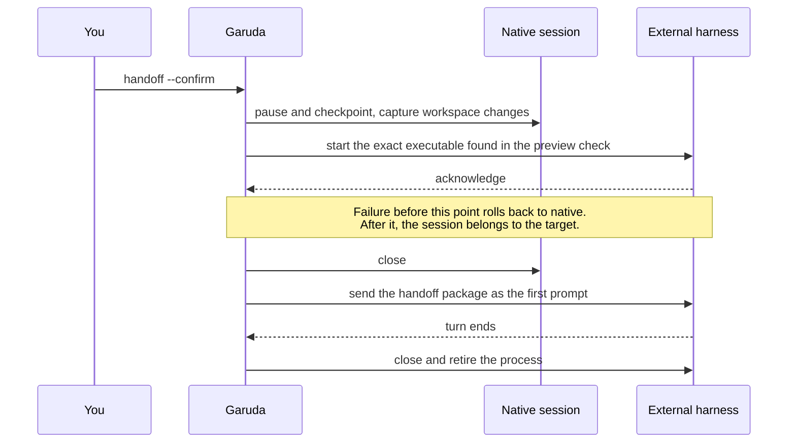
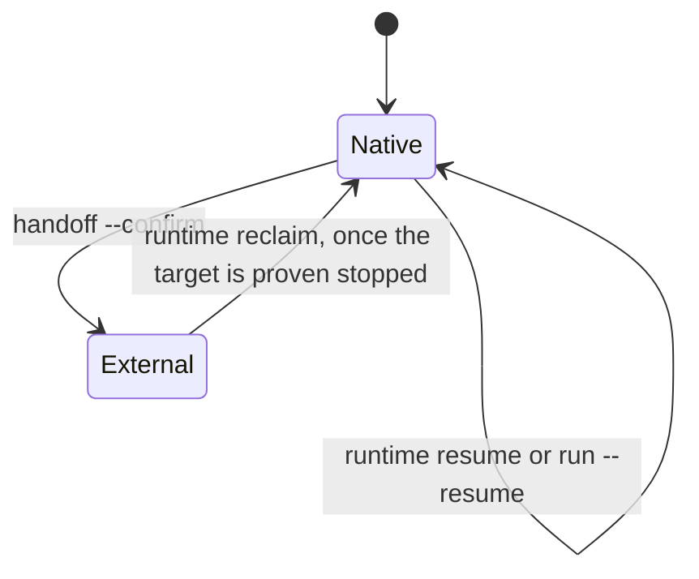
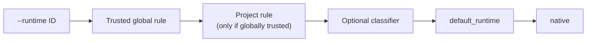

# Level 7 · Advanced

<span class="gd-level">Level 7</span> Use subscription-backed coding harnesses
through ACP, move sessions between runtimes, choose runtimes automatically,
and add a second model.

!!! danger "External harnesses are not confined by Garuda"
    An external harness runs as **its own process on your machine** with its
    own permissions. Garuda's run modes, permission rules, Docker and sandbox
    workspaces, and completion checks do not apply to it. Garuda records the
    session, approvals, and workspace changes. "Completed" means the harness
    ended its turn, not that Garuda verified the result.

## See which external harnesses are ready

<p class="gd-facts">Changes files: no</p>

```bash
garuda runtime list
garuda runtime inspect claude
```

**What happens:** Garuda checks each entry in its trusted catalog (`claude`,
`codex`, `cursor`, `opencode`, `pi`, `goose`, `omp`): is the executable installed,
what version it is, what it can do, and setup hints. Login and quota show as
`unknown` unless the vendor reports them; Garuda never reads credential files to
find out. Add `--json` for machine-readable output.

### Install a harness

You install and log in to each vendor's CLI yourself. Garuda launches it but
never reads, copies, stores, or proxies your vendor login.

=== "Claude Code"

    Install [Node.js 22+](https://nodejs.org/en/download) (including npm), then
    [Claude Code](https://code.claude.com/docs/en/setup#install-with-npm) and its adapter:

    ```bash
    npm install -g @anthropic-ai/claude-code
    claude   # first run: log in with your Claude Pro/Max account, then exit
    claude auth status
    npm install -g @agentclientprotocol/claude-agent-acp@0.85.0
    claude-agent-acp --version
    garuda runtime inspect claude
    ```

    Don't set `ANTHROPIC_API_KEY` if you want to use your subscription.

=== "Codex"

    Install [Node.js 22+](https://nodejs.org/en/download) (including npm), then
    the [Codex CLI](https://learn.chatgpt.com/docs/codex/cli) and its adapter:

    ```bash
    npm install -g @openai/codex
    codex login   # sign in with ChatGPT
    codex login status
    npm install -g @agentclientprotocol/codex-acp@2.1.1
    codex-acp --version
    garuda runtime inspect codex
    ```

=== "OpenCode"

    ```bash
    npm install -g opencode-ai
    opencode --version
    garuda runtime inspect opencode
    ```

    Log in through OpenCode's own configuration.

=== "Cursor"

    Install and log in to the Cursor Agent CLI, then:

    ```bash
    agent --version
    garuda runtime inspect cursor
    ```

=== "Pi"

    Install the `pi-acp` package and log in to Pi, then:

    ```bash
    pi-acp --version
    garuda runtime inspect pi
    ```

=== "Goose"

    Install and log in to Goose, then:

    ```bash
    goose --version
    garuda runtime inspect goose
    ```

=== "oh-my-pi (omp)"

    Install the `omp` CLI and log in with `omp login`, then:

    ```bash
    omp --version   # checked: omp/18.16.0
    garuda runtime inspect omp
    ```

    `omp` is its own runtime (`omp acp`), not the `pi` adapter. Only its
    launch, handshake, idle cancel and shutdown were checked, so prompted
    turns, permission requests and harness modes are unverified. See the
    [conformance report](../development/omp-acp-conformance.md).

Node 22+ is recommended for both examples. In primary npm package metadata
checked on 2026-10-23, [Claude Code 2.1.309](https://registry.npmjs.org/%40anthropic-ai%2Fclaude-code/2.1.309)
and the [Claude adapter 0.85.0](https://registry.npmjs.org/%40agentclientprotocol%2Fclaude-agent-acp/0.85.0)
both declare Node 22+. The [Codex CLI 0.164.0](https://registry.npmjs.org/%40openai%2Fcodex/0.164.0)
declares Node 16+, while the [Codex adapter 2.1.1](https://registry.npmjs.org/%40agentclientprotocol%2Fcodex-acp/2.1.1)
does not declare `engines.node`; its `open` `^11.0.1` runtime dependency
currently resolves to [open 11.0.4](https://registry.npmjs.org/open/11.0.4),
which declares Node 20+. Node 20+ is therefore the highest published direct
runtime requirement for that checked Codex path, rather than a minimum declared
by the adapter itself. Newer CLI or dependency releases can raise these requirements.

The pinned Claude Code and Codex adapter versions are the ones on which Garuda
has proven a role's `model_id`, `effort`, and `harness_mode`. Garuda refuses
roles that set these options on an unproven adapter (`role.options_unproven`)
before sending a prompt. Omit the version pin only if your roles leave all
three unset. Run `garuda doctor --runtime claude` (or `--runtime codex`) to
check the install and login.

Details and limits for each vendor are in the
[External harnesses guide](../guides/external-harnesses.md#vendor-setup).

## Run a task with Claude Code, Codex, or another harness

<p class="gd-facts">Changes files: yes, by the harness · Runs on: your machine · Needs: the vendor CLI</p>

```bash
garuda run --runtime claude -t "Add type hints to src/utils.py"
```

**What happens**

1. Garuda resolves the trusted catalog entry. An unknown, disabled, or
   missing runtime is refused.
2. It locks the workspace, records a session and the starting state, and
   launches the exact executable it found.
3. Approval requests from the harness reach you as a `y/N` prompt on an
   interactive terminal. In a headless run they are denied and recorded.
4. When the harness ends its turn, Garuda records the workspace changes and
   stops the process.

`--check`, `--no-edits`, `--name`, `--bg` and `@name` briefs work the same way
with a harness. `--isolation` and the workspace kinds don't apply: the harness
works in your checkout. To pin the harness's model and effort, run it as a
[role](teams.md#run-a-task-as-a-role); Garuda sets them before the first prompt
on adapter versions where that was proven, and refuses otherwise.

To verify selected criteria after a standalone harness run, supply an explicit
acceptance check:

```bash
garuda run --runtime codex -t "Fix the failing tests" --check "pytest -q"
```

The harness ending its turn and the check passing are separate outcomes.
Garuda records the check's authority, workspace fingerprint and result. This
post-run verification does not enforce the native completion gate inside the
harness or confine the harness's tools. Checked flows have separate recovery
eligibility rules; this standalone example does not enroll a flow in recovery.

If an installed harness fails to **start** and the workspace is unchanged,
Garuda moves the session once to `fallback_runtime` (native by default) and
records why in the session. The native run then uses your model API key.

## Hand off a Garuda session to an external harness

<p class="gd-facts">Changes: session ownership · Preview first, then confirm</p>

**Use it when** a native session has done the groundwork and you want a
harness to continue it.

```bash
garuda runtime handoff --session latest --to codex
garuda runtime handoff --session latest --to codex --confirm
```

The first command only previews. The second runs a one-shot transaction:



The handoff package holds bounded task state, evidence references, and the
workspace changes. It never contains vendor credentials, raw secrets, or the
full transcript. Add `--workspace DIR` if the session recorded a relative
path and you're running from somewhere else.

## Recover or take back a session

<p class="gd-facts">Changes: session ownership only</p>

**Use it when** a run was interrupted, or a harness finished and you want
Garuda's native loop to continue.



```bash
garuda runtime recover --session latest
garuda runtime reclaim --session latest
garuda runtime resume --session latest -t "Continue after the external run"
```

- `recover` classifies the session as `resumable`, `rolled_back`, or
  `external` (owned by a harness that may still be acting).
- `reclaim` returns an `external` session to native. It refuses while a
  workspace lock, a live recorded process, or an active target state says the
  harness might still be running. It repairs ownership; it does not undo the
  harness's changes.
- `resume` continues a native session with a new task.

**Continue on a different runtime.** `--resume` with `--as` starts a new,
linked session on another runtime, seeded with the old session's brief (its
task, state, changed files, checks and final answer, never the transcript):

```bash
garuda run --resume latest --as claude -t "Finish the remaining TODOs"
```

Resuming a session that an external harness ran uses the harness's own
session reload only on adapter versions where that was proven; otherwise it
also starts a linked session from the brief. A session whose owner is still
running refuses.

Need help from someone else? The default command prints a redacted diagnostic
bundle with a versioned failure projection:

```bash
garuda runtime support --session latest
garuda runtime support --session latest \
  --select causes,identities,review,acceptance --preview
# Review the exact JSON and copy its digest, then capture only if wanted:
garuda runtime support --session latest \
  --select causes,identities,review,acceptance \
  --capture --confirm-digest DIGEST_FROM_PREVIEW
garuda runtime support --session latest \
  --select causes,identities,review,acceptance --export > diagnostic.json
```

Preview and export only read the selected session. They do not probe a
provider, inspect credentials, run Git, replay work, repair records or prune
snapshots. Capture revalidates the preview digest and publishes an owner-private
snapshot. A session keeps at most eight snapshots and 2 MiB for seven days.
Capture removes abandoned private staging files under its lock and refuses a
directory with more than 64 entries or unsupported files. Inspection reports a
sparse recorded failure separately from an unavailable explanation.
Raw transcripts, reasoning, tool arguments, protocol frames and vendor auth are
outside the schema. Older sessions can therefore show `unavailable`; Garuda
does not infer a cause from event counts or a later quota refusal.

## Fork an earlier conversation context

Use a [collection brief](#add-a-cheaper-model-for-investigation) or a named
session's brief when you only need findings. Use an explicit fork to continue
from an earlier point in a saved native conversation:

```bash
garuda sessions fork-preview SOURCE_SESSION --at 5 --json
garuda run --fork SOURCE_SESSION --fork-at 5 -t "Try the other approach"
garuda sessions show latest --json
```

Preview validates the same terminal native source and complete tool-batch prefix
as execution. It reports the requested/effective indices, source digests,
historical receipt references and stale evidence without revealing transcript
text. It reads only: no model, environment, session, lease or capacity reservation
is created, and files/processes are unchanged. Admission is explicitly **not
checked**; a later run must pass ordinary admission and revalidate its source.

Names, prefixes and `latest` require the store's existing project identity key.
Preview refuses a missing or malformed key without creating locks or repairing
identity. A full session ID can still select its explicit source without that
key. Invalid saved handoffs, runtime segments or message shapes produce a clean
refusal (exit 2) rather than a traceback.

Preview shares an 8 MiB source-read allowance across metadata selection, checkpoint
preparation and the final source recheck, including oversize detection. Exhaustion
refuses with exit 2; it never validates a partial source. `latest` also refuses
non-string saved timestamps rather than guessing an order. Missing legacy
timestamps retain their existing empty-string ordering. Native fork execution
keeps its full-checkpoint read policy and can accept sources too large to preview.

`--fork-at` is an inclusive, zero-based index in the source session's
`messages.json` checkpoint, including system and tool messages. Index 5 retains
messages 0 through 5. It addresses the saved checkpoint, which may already be
compacted; it is not an index into the append-only event log. If the point cuts a
tool batch, Garuda backs up before that batch and records the requested and
effective indices (`-1` means the entire prefix was an incomplete batch).

The new session records `forked_from`, source-file SHA-256 digests and
`source_digest`, plus **context rewind only**: filesystem and processes were
not restored. Your current workspace is used with ordinary lease and capacity
admission and a fresh baseline. Earlier check results and candidate claims are
stale; the fork must verify its current work. Constraints survive in the working
state; source events, state and receipt locations remain historical references.
Missing artifacts retain unavailable/unknown status instead of becoming evidence.
`garuda sessions show` reads lineage without starting work.

This slice accepts terminal native sessions without pending ownership or
quarantine. It refuses ACP sources, live sources, `--resume`, `--as`, `--bg`, and
worktree creation with a fork. To fork context from a worktree session, select
its current directory explicitly with `--workspace`; no old worktree is restored.
Session names, prefixes and `latest` use the same project selection as resume.

The SDK uses the same runner and admission path:

```python
from garuda.sdk import SoftwareAgent

result = await SoftwareAgent(workspace=".").run(
    "Try the other approach", fork="SOURCE_SESSION", fork_at=5,
)
```

## Route tasks to runtimes automatically

<p class="gd-facts">Configured in: <code>~/.agent/settings.yaml</code> (trusted, global)</p>

**Use it when** certain kinds of tasks should always start on a particular
runtime.

```yaml
# ~/.agent/settings.yaml
routing:
  default_runtime: native
  rules:
    - id: readonly-review
      priority: 100
      runtime: codex
      when:
        agents: [reviewer]
        modes: [readonly]
```

Garuda picks the starting runtime from the first source that applies:



Naming a runtime with `--runtime` pins it, including `--runtime native`; omit
the flag to let rules pick another runtime. Every condition in a rule must match; higher `priority` wins. An optional
classifier model can pick between approved candidates when no rule matches.
Its answer is re-checked, and on any doubt the default is used. See
[Configuration → initial runtime selection](../guides/configuration.md#initial-runtime-selection).

## Skip a harness whose subscription limit is used up

<p class="gd-facts">Needs: a role with a <code>fallback</code> · Reads: only documented status sources</p>

**Use it when** a role's main harness sometimes hits its plan limit and you'd
rather start on the fallback than fail.

Open the dashboard's **Providers** page and press **Refresh**, or let a run
read it. Garuda skips a harness as `harness.limit_reached` only when all of
these hold at the moment it picks one:

- the limit source is proven for that exact CLI version (today: Codex's
  app-server rate-limit read; Claude Code has no documented non-interactive
  source, so it always reads *unknown*);
- the reading names the account you're logged in with now, and is at most a
  minute old;
- it says the limit is reached, with a reset time that hasn't passed.

Anything else leaves the harness eligible: an unknown limit never blocks a
harness. This happens once, before the first prompt. See
[External harnesses → usage and limit sources](../guides/external-harnesses.md#usage-and-limit-sources).

## Add a cheaper model for investigation

<p class="gd-facts">Configured in: <code>~/.agent/settings.yaml</code> · Off by default</p>

**Use it when** the main model spends many turns reading and searching, and a
faster model could gather evidence in parallel.

```yaml
# ~/.agent/settings.yaml
models:
  strong:
    model: openrouter/example/reasoning
  fast-reader:
    model: openrouter/example/fast-reader
model_bindings:
  default:
    reasoning: strong
    collection: fast-reader
model_bindings_default: default
collection:
  enabled: true
  profile: explore
  handoff: brief
```

**What happens**

- Settings in a profile or project can also turn collection on, and a
  collection model must be bound.
- The main model stays in control and must explicitly call
  `delegate_collection`. Collection jobs are bounded and read-only; they can't
  edit files or finish the task.
- Each job's full trace is saved under the parent session's `subagents/`
  folder.
- `--no-collection` turns the role off for one run.

Budgets and evidence rules: [Configuration → bounded collection model](../guides/configuration.md#bounded-collection-model).

## Use Garuda from an ACP editor

<p class="gd-facts">Garuda acts as the agent side of an ACP session over stdio</p>

```bash
python -m garuda.acp.server --workspace /path/to/workspace
```

Point an ACP-capable editor at this command to use Garuda's native agent from
the editor.

## Debug an agent-launched Python script

Install `debugpy==1.8.19` into the Python environment running Garuda. Save this
explicitly selected definition as `.agent/agents/debug-python.yaml`:

```yaml
version: 1
extends: garuda/build
tools:
  add: [debug_launch, debug_inspect, debug_variables, debug_control]
  options:
    debug_launch:
      max_variables: 30
      max_depth: 2
      max_chars: 8000
      output_chars: 10000
```

```bash
garuda run --agent-file .agent/agents/debug-python.yaml --workspace-kind local --permission-mode smart \
  -t "Launch demo.py with a breakpoint at line 10. Inspect its stack and local variables, step into the failing function, then disconnect. Run pytest independently to check the fix."
```

The agent calls `debug_launch` with `program: demo.py` and `breakpoints: [10]`.
It uses the returned `debug_session_id` for `debug_inspect` operations
`stackTrace`, `scopes`, `output` and `status`; `debug_variables` accepts
`operation: variables`. Frame and variable `handle` values come from the
preceding inspection. `debug_control` supports
`next`, `stepIn`, `stepOut`, `continue`, `disconnect` and `terminate`. Handles
expire when execution resumes. Without breakpoints, launch stops on entry.

Adapter replies and stop waits are bounded to 15 seconds. A timeout reports an
error and retains owned sessions; a launch that is still running includes its
`debug_session_id` in the error. Use `status` to observe a later stop or
`disconnect` to close it. An unanswered request leaves state `unknown` until a
later adapter event establishes it. Run cancellation or the run deadline reaps
all debug sessions owned by that agent session.

The tools are absent by default, including from `all` and `read-only` presets.
Launch runs code and uses bash permission rules; readonly denies launch,
execution control and variable rendering. Only agent-launched files physically
inside a local workspace are accepted. Docker, remote, sandbox and tmux
workspaces refuse debugging; their ordinary tools keep their existing requirements.

Hard caps are 100 breakpoints, 32 stack frames, 100 variables across a recursive
inspection, depth 3, 12,000 stack/scope/variable response characters and 20,000
captured output characters. Options lower these limits; `max_chars` has a
minimum of 1024 for the evidence envelope. Output is a bounded tail with a
truncation flag. Adapter capabilities are reported separately from Garuda's
supported subset.

Attach, evaluate, explicit getters, arbitrary object expansion, setVariable,
memory and raw DAP requests are unsupported. Debugpy may call user `repr` methods
while rendering variable summaries, which require mutating authority. The
service is a debugging guardrail, not confinement. Disconnect and teardown kill
and verify the issued POSIX session,
including the debuggee's process group. Unavailable process-table evidence or
unsettled processes report **cleanup unproved** and retain quarantine; daemons
that leave the session are outside this ownership proof. Process-table access
and local sockets must be available. Debugger observations do not establish
that a fix passes independent acceptance checks.

## Benchmark and evaluate

<p class="gd-facts">For: measuring Garuda, not day-to-day work</p>

```bash
garuda run --mode eval --trajectory run.jsonl -t "Make the failing tests pass"
```

`--mode eval` applies the benchmark-grade completion checks, and
`--trajectory` saves the run's events for analysis. For benchmark setups and
paired dual-model reports (`garuda eval dual-model report ...`), see
[Evaluation](../evaluation/index.md).

## Run offline incident regressions

```bash
python -m garuda.eval.contract_matrix --incidents --out incident-reports
```

This opt-in corpus creates temporary synthetic Git repositories and runs
ScriptModel responses without provider calls or credentials. Inspect
`incident-reports/incidents-v1.json` for separate model completion, authorized
acceptance, coverage and unknown cost. Six contracts currently pass; partial
tool arguments are explicitly expected-fail because a well-formed prefix on
a length-truncated response can execute. Exit zero means the corpus recorded
its expected outcomes, including that gap. It does not mean every guard exists.
See [Evaluation](../evaluation/index.md#offline-incident-evidence) for scope and
controlled comparisons.

## Aggregate tool results in a confined Python cell

Add `code_cell` explicitly to an agent definition; it is absent from default
and `all` tool selections. The cell is mutating and cannot run in read-only mode.

```yaml
version: 1
name: cell-investigator
extends: garuda/build
tools:
  add: [code_cell]
  options:
    code_cell:
      timeout: 10
      output_bytes: 32768
      nested_calls: 8
```

Save this as `.agent/agents/cell-investigator.yaml`. With Docker available,
preinstall `python:3.12-slim` on the selected daemon yourself (for example,
`docker pull python:3.12-slim`), then run:

```bash
garuda run --agent cell-investigator --workspace-kind docker -t "Use a code cell to count lines in README.md and return only the count."
```

The model can call `code_cell` with this code:

```python
reply = tool("read_file", {"path": "README.md"})
if reply["is_error"]:
    raise RuntimeError(reply["content"])
result = {"lines": len(reply["content"].splitlines())}
```

`inputs` is an optional JSON object. Assign a JSON-serializable `result`; printed
text is also returned. The scratch worker has no workspace mount or network.
Every `tool` request is screened and recorded by the ordinary host ToolRunner;
a denied write stays denied. Intermediate replies stay inside the cell, while
session events retain nested receipts with cell id and request index.

Defaults are 10 seconds, 32 KiB output, eight nested requests, and 32 KiB combined
code/input. Options may set positive values up to 30 seconds, 64 KiB output and
32 requests; run deadlines may shorten execution. The timeout counts the cell's own
launch and code, not time spent inside nested `tool` calls: a nested `bash` call
waiting for your approval, or running its own longer timeout, does not use up the
cell's budget. Bridge frames/replies are also
bounded at 64 KiB. Cancellation, time/output/request limits and worker death
terminate the cell; interrupted effects remain unknown and are never replayed
automatically. Container/process cleanup can take additional bounded time.

Linux `--workspace-kind sandbox` supports cells only when bubblewrap can launch
and Garuda's Python resides in its mounted system runtime paths. macOS Seatbelt,
local, tmux and environments without this capability explicitly refuse. Docker
and remote Docker use a separate preinstalled cell image, so the workspace's own
image does not need Python. Cells cannot invoke another code cell.
