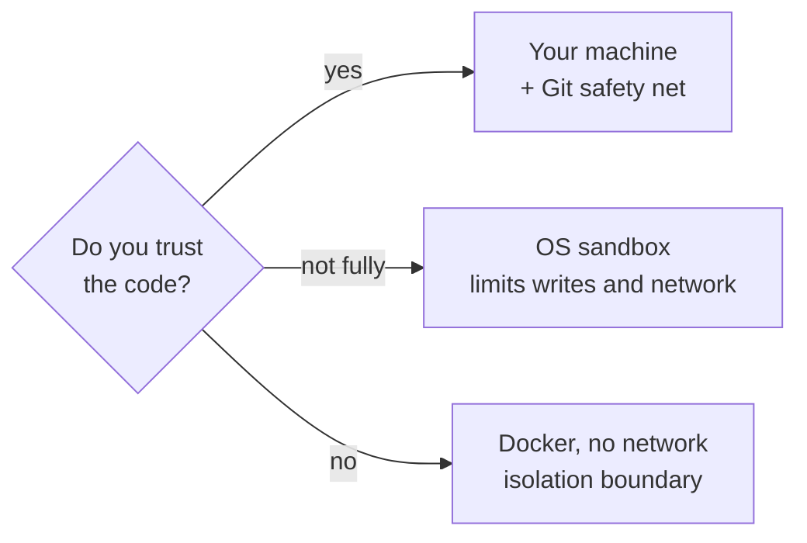

# Level 2 · Change code

<span class="gd-level">Level 2</span> Garuda edits files and runs commands.
Start on your own machine with Git as a safety net. Move to Docker when the
code isn't yours to trust.



## Fix a bug with a Git safety net

<p class="gd-facts">Changes files: yes · Runs on: your machine · Needs: Git</p>

**Use it when** you have a known bug or failing test in a repository you trust.

```bash
git status
garuda run -t "Fix the failing test in tests/test_parser.py, then run it to confirm"
git diff
```

Start from a clean tree (or commit first) so `git diff` shows only Garuda's
work. Keep the result with `git commit`; throw it away with `git restore .`
and delete any new files that `git status` lists.

**What happens**

- The default `build` profile can edit files and run commands, including your
  tests.
- Dangerous commands, such as writing to a raw device, are refused.
- Risky commands, such as `sudo`, `chmod`, recursive `rm`, or piping a download
  into a shell, need approval. `garuda run` has nobody to ask, so they are
  denied and recorded. Use [`garuda chat`](#chat-and-approve-risky-actions-yourself)
  to approve them yourself.
- Garuda records the starting state, so the session's changes stay separate
  from edits that were already there.

## Chat and approve risky actions yourself

<p class="gd-facts">Changes files: yes · Runs on: your machine · Interactive</p>

**Use it when** you want to steer the work turn by turn.

```bash
garuda chat --workspace .
```

**What happens**

- Type a task at the `task>` prompt. The agent works, then waits for the next
  one, keeping the conversation.
- When it wants a risky action, you see
  `[garuda] Approve <action>? [y/N]`. Anything but `y` or `yes` denies it.
  The prompt appears when the profile's own permission mode is `smart`, as
  with the default `build` profile; other profiles deny asks.
- Press ++enter++ on an empty line, or ++ctrl+d++, to finish.
- Away from that terminal? While the prompt waits, you can answer it from
  another one, or from the dashboard's Approvals page. See
  [answer an approval from elsewhere](parallel.md#answer-an-approval-from-another-terminal-or-the-browser).

Add `--mode readonly` for a read-only chat, or `--agent plan` to discuss a
plan before building it.

## Work with the agent in your browser

<p class="gd-facts">Changes files: yes · Opens: a local web page</p>

**Use it when** you prefer a visual chat with live tool calls, diffs, and
approval buttons.

```bash
garuda web --allow-workspace . --max-permission smart
```

**What happens**

- The dashboard can start native conversations, but only in directories you
  listed with `--allow-workspace` (repeat the flag for more).
- A browser request can ask for `--max-permission` or something stricter,
  never looser.
- You can attach files or URLs as grounding. They are saved under `grounding/`
  in the workspace and read by the agent with its normal tools.
- If the browser abandons an approval, Garuda denies it instead of waiting
  forever.

More in the [Web dashboard guide](../guides/web-dashboard.md).

## Verify the result with your own check

<p class="gd-facts">Changes files: yes · Works with external harnesses too</p>

**Use it when** "done" should mean "your test command passes", not "the agent
says so".

```bash
garuda run --name fix-tests -t "Fix the failing tests by changing src/ only" --check "python -m pytest -q"
```

```text
[garuda] verification: passed (user-request)
```

**What happens**

- After the session ends, Garuda runs each `--check` command (repeat the flag
  for more) and records a receipt: who asked for it, the exact command, the
  code it ran against, and the result.
- The session's **verification** becomes `passed` or `failed`. It is kept
  apart from the agent's own **self-check**, so `garuda sessions show
  fix-tests` shows both.
- Without a check, verification reads `unavailable`. Checks can also come
  from your `garuda.yaml` or a project file you trusted; see
  [Level 5](teams.md#require-checks-for-every-run-in-this-project).
- A check can't pass if it changes the code it checks, or if the session
  changed the test setup it relies on (for example `conftest.py` for pytest).

## Inspect post-edit diagnostics

Native `write_file`, `edit` and `multi_edit` keep successful, clean edits quiet.
Direct tool callers can inspect advisory checker state without treating silence
as proof that a checker ran:

```python
import asyncio
from tempfile import TemporaryDirectory

from garuda.tools.files import WriteFileTool
from garuda.tools.protocol import ToolContext
from garuda.workspace.local import LocalEnvironment

async def demo():
    with TemporaryDirectory() as workspace:
        result = await WriteFileTool().execute(
            {"path": "example.json", "content": '{"answer": 42}\n'},
            LocalEnvironment(workspace_root=workspace),
            ToolContext(session_id="diagnostic-demo"),
        )
        syntax = result.metadata["diagnostics"]["checkers"]["syntax"]
        print(syntax["status"], syntax["ran"], syntax["source_version"])
        # clean True <SHA-256 of the checked file>

asyncio.run(demo())
```

Each checker reports `available` (`None` if unobserved), `ran`, `source_version`,
`status` and `duration_ms`. A missing executable is `unavailable`; crashes,
timeouts and observed content changes are `error`. Compare the digest with the
current file before reusing a result. Diagnostic lists and text are bounded;
`complete: false` discloses omitted details.

On violations, `edit` and `multi_edit` can compare known pre-edit content.
Diagnostics are `introduced` against a clean baseline, or `preexisting` when
the same diagnostic and its source prefix are unchanged. Ruff can also identify
new diagnostic identities against a complete baseline. Changed/moved matches,
failed or incomplete baselines, baselines over 64 KiB and Node module ambiguity
stay `unknown`. Whole-file writes do not read a baseline and use `unknown`.
Clean edits do not run baseline checkers.

This state is returned to direct tool callers; it is not an acceptance receipt
or a persisted session verification result. Use an authorized
[`--check`](#verify-the-result-with-your-own-check) for acceptance verification.
Project-aware commands retain their existing trust requirements.

## Make Garuda prove the fix

<p class="gd-facts">Changes files: yes · Costs: extra model calls</p>

**Use it when** "it says it's done" isn't good enough and you want the agent
to gather evidence before it stops. These modes make the agent check its own
work; pair them with [`--check`](#verify-the-result-with-your-own-check) when
you also want an independent result.

```bash
garuda run --mode eval -t "Make tests/test_parser.py pass without changing the tests"
garuda run --mode rigorous -t "Fix the date parsing bug and show evidence that it is fixed"
```

| Mode | Adds before accepting "done" | Extra cost |
|---|---|---|
| `eval` | Acceptance criteria, an LLM judge, and evidence that is discriminating and stable | About two model calls per completion attempt |
| `rigorous` | Everything in `eval`, plus a plan → execute → critique → repair cycle | More than `eval` |

If a check fails, the agent goes back to work instead of finishing.

## Run untrusted code in Docker

<p class="gd-facts">Changes files: yes, inside the mounted project · Runs in: a container · Needs: Docker</p>

**Use it when** the repository, its dependencies, or its tests aren't yours to
trust.

```bash
garuda run --workspace-kind docker --docker-image python:3.12 --no-network -t "Run the test suite and summarize the failures"
```

**What happens**

- Commands run in a container with the project mounted at `/workspace`.
- `--no-network` switches the container to Docker's `none` network. Without it,
  networking is bridged.
- Default limits are 2 GiB of memory and 2 CPUs. Change them with
  `--docker-memory 4g --docker-cpus 4`.
- The default image is `ubuntu:22.04`. Pick one that already has your toolchain.

!!! warning "What Docker does not cover"
    - **The host side.** Garuda itself, model calls, `web_fetch` and
      `web_search`, and any project tools or hooks you enabled run on the host.
    - **MCP servers.** They start on the host, including ones the repository
      defines in `.agent/mcp.json` or `.cursor/mcp.json`. For an untrusted
      repository, add `--mcp-config` pointing at an empty `{}` file outside it.
    - **Offline installs.** With `--no-network` the container can't download
      dependencies. Use an image that has them, or drop `--no-network`.

??? note "Use another machine's Docker"

    ```bash
    garuda run --workspace /srv/project --workspace-kind remote --docker-host ssh://builder.example --no-network -t "Run the test suite"
    ```

    The workspace path must already exist **on the remote host**: Garuda passes
    it as a bind mount and does not copy files. Use only a Docker daemon and
    SSH or TLS setup you trust.

## Limit writes and network with the OS sandbox

<p class="gd-facts">Changes files: yes · Runs on: your machine, under Bubblewrap or Seatbelt</p>

**Use it when** you want less blast radius than plain local runs but can't use
Docker.

```bash
garuda run --workspace-kind sandbox -t "Run the tests and fix the failure"
garuda run --workspace-kind sandbox --allow-network -t "Install the dependencies and run the tests"
```

**What happens**

- Linux uses Bubblewrap and macOS uses Seatbelt to restrict writes and network.
- Network is **denied** by default. `--allow-network` permits it for one run.
- If no sandbox backend is available, Garuda refuses to start.

!!! danger "Know the limits"
    The sandbox does **not** stop the agent reading host files.
    `--allow-unsandboxed` turns the refusal into unconfined host execution. It
    is an availability escape hatch, not a safety boundary.

## Refuse edits to files that changed since they were read

<p class="gd-facts">Opt-in per agent · Works with any workspace · A precondition, not a lock</p>

**Use it when** files may change under the agent (you edit alongside it, or
another tool writes to the tree) and a still-matching replacement must not
land on content the agent never saw.

```yaml
# .garuda/agents/careful.yaml
version: 1
extends: garuda/build
tools:
  options:
    edit: {contract: versioned}
    multi_edit: {contract: versioned}
```

```bash
garuda run --agent careful -t "Rename the retry setting in config.py"
```

**What happens**

- Every `read_file` reports `(version: v1:…)`, a token for the full content
  of the file (not only the lines shown), this session and this path. A
  `tail` or `bounded` read of a large file reports `version: unknown`, and an
  edit naming it is refused until the file is read without them.
- `edit` and `multi_edit` must pass that token as `expected_version`. If the
  file changed since, or the token belongs to another file or session, the
  edit is refused and nothing is written; the agent reads the file again.
- A successful edit reads the file back and reports the version that read
  sees, so a following edit can chain. If the file cannot be read back as the
  edit wrote it (another writer got there first), the version is reported as
  unknown and the agent reads the file again.
- With the default `legacy` contract, edits work as before. A token is
  optional there and checked only when given.
- The check runs on the content the edit itself reads. A writer that changes
  the file in the moment between that read and the write is not prevented.

## Cap time, turns, and cost

<p class="gd-facts">Works with: any native run</p>

**Use it when** you want a run to stay small and predictable.

```bash
garuda run --deadline-sec 900 --max-turns 30 -t "Fix the flaky test in tests/test_cache.py"
```

- `--deadline-sec` sets a wall-clock budget. The agent paces itself against it
  and keeps turns in reserve to finish cleanly.
- `--max-turns` caps the number of agent turns.
- `--max-run-tokens` caps tokens across the whole native run tree: the main
  calls, summaries, the verifier, rigorous mode's plan and critic, and every
  native subagent and native consult (including advisors) share one budget.
  Each call reserves its estimate first, so parallel
  calls cannot spend the same remainder; a call whose provider reports no token
  usage is charged that estimate. When the budget is gone the run stops with
  `spend_limit`, and the session records the final `spend_gate` snapshot.
- `--max-run-cost-usd` stops admitting calls once provider-reported spend
  reaches the amount. It is a stop, not a prepaid maximum: a call in flight
  can overshoot. If a completed call returns no provider-reported cost, the
  dollar budget cannot be enforced for that model and no further calls are
  admitted, unless `--max-run-tokens` is also set; use it for models whose
  pricing is unavailable. A call the provider rejected outright (for example
  an oversized prompt) does not count as unpriced.
- Both caps bound Garuda's native loop only. An ACP runtime makes its own model
  calls, so `garuda run` refuses either flag there and capped native runs refuse
  ACP consult targets with `consult.spend_unsupported`; a
  token cap below 1 or a cost that is not a finite amount above 0 is refused too.

```bash
garuda run --max-run-tokens 400000 --max-run-cost-usd 2 -t "Refactor the cache module"
```

- A resumed run (`--resume`) with these flags continues from the source
  session's recorded tree spend (`spend_gate` in its `meta.json`) instead of
  starting at zero; the new session records what it inherited under
  `spend_inherited`. If the source recorded no spend (it ran without these
  flags), prior spend is unknown: a dollar-only budget then refuses to admit
  calls, and a token budget starts from zero and says so.

- Check the `[garuda] reasoning=…` line at startup to confirm the model.
- Start with the default mode. `eval` and `rigorous` add model calls.
- Your provider's billing page is the authority on cost. Garuda does not guess
  missing prices.
- To see what runs actually used, open the dashboard's
  [Usage page](parallel.md#see-usage-cost-and-limits).

## Name a session and build on it

<p class="gd-facts">Changes files: depends on the task · Shares: a short brief, never the transcript</p>

**Use it when** a later task should know what an earlier one did, without you
re-explaining it.

```bash
garuda run --name fix-tests -t "Fix the failing tests"
garuda run --no-edits -t "In two sentences, explain what @fix-tests changed and why"
garuda run --with fix-tests --with add-docs -t "Write the release note for these changes"
```

```text
[garuda] tagged: fix-tests (native · openrouter/deepseek/deepseek-v4-flash-0731)
```

**What happens**

- `--name` gives the session a name that is unique in this project. Without
  it, Garuda makes one from the task. Names work anywhere a session ID does:
  `--resume fix-tests`, `garuda sessions show fix-tests`.
- `@fix-tests` in the task, or `--with fix-tests`, attaches that session's
  **brief**: its task, state, changed files, checks and final answer. The
  transcript is never attached. The brief arrives as labelled data, not as
  instructions.
- A session from another project needs its full ID, `--with-id FULL_ID`, and
  your permission: Garuda asks in a terminal, or you pass
  `--allow-cross-project-context` in a script.
- In `garuda chat`, `@name` works in any message.

!!! tip "Brief or resume?"
    `--resume` continues the conversation itself, with the full history.
    `@name` and `--with` start fresh and hand over only the brief, which keeps
    the new run's context small.

## Use a different model for one run

<p class="gd-facts">Needs: the provider's API key</p>

```bash
export ANTHROPIC_API_KEY=...   # placeholder
garuda run --model anthropic/MODEL_ID -t "Refactor utils.py into smaller functions"
garuda run --reasoning-effort high -t "Find the race condition in the job queue"
```

- Replace `MODEL_ID` with the provider's model name. `--model` accepts any
  LiteLLM `provider/model` name and beats model environment variables and
  configured bindings.
- `--reasoning-effort minimal|low|medium|high` turns on extended thinking
  across providers. `--thinking-budget TOKENS` sets an Anthropic thinking
  budget.

To change the default for every run, see [Configuration](../guides/configuration.md#models).

### Inspect why a model response ended

Callers using the model helpers can distinguish a token limit from a normal
stop without examining the generated text:

```python
from garuda.model import LitellmModel
from garuda.types import Message, Role

model = LitellmModel("anthropic/MODEL_ID")
messages = [Message(role=Role.USER, content="Summarize the repository")]

ordinary = await model.complete(messages)
streamed = await model.complete_streaming(messages)
print(ordinary.raw["finish_reason"], streamed.raw["finish_reason"])
```

Both response paths expose the provider's `finish_reason` and `status` in
`ModelResponse.raw`. The lower-level `model.stream()` exposes the same optional
values on `StreamDelta`. A provider that omits a value produces `None`; Garuda
does not guess from content, tool calls, stream exhaustion, or `done=True`.
Empty terminal chunks and later usage-only chunks preserve an observed value.

These are model-helper APIs. Native `garuda run` attaches live output in a
terminal as described below; `garuda chat` still renders completed turns.
External harness streaming follows its separate runtime path.

### Watch assistant text live in the terminal

```bash
garuda run -t "Explain how the request router works"
garuda run --no-stream -t "Explain how the request router works"
garuda run --quiet -t "Explain how the request router works"
garuda run --json -t "Explain how the request router works" > events.jsonl
TERM=dumb garuda run -t "Explain how the request router works"
```

On a TTY, native `run` shows assistant text as it arrives. The preview is
transient: the assembled response replaces it once. If streaming fails, the
preview is erased before the ordinary retry, whose completed answer replaces
it. Cancellation or a failed call closes the preview. Only assistant text is
shown live; reasoning and tool argument fragments are not. Complete tool calls
and results use the existing terminal renderer.

`--no-stream` keeps ordinary final-message output. `--quiet` also suppresses the
native startup/model notices. JSON and redirected stdout automatically keep the
ordinary path, without terminal control codes. No-edits runs also keep that path
so outputs can be withheld if their check fails. A model without a streaming API
still works through `complete()`.

Rich is optional. With it, the preview shows the last terminal-height-minus-one
wrapped lines; without it, a bounded single-line preview shows the latest text.
Previews refresh at most ten times per second. Dumb terminals (or an unset
`TERM`) show completed responses without previews or preview erase codes. The full
assembled response is always printed, and final output that repeats any already
rendered response is suppressed, including when the run exhausts its turn budget.
This native consumer is still not attached to
chat, the web dashboard, SDK entry points or ACP surfaces.

### Watch assistant text in dashboard chat

```bash
garuda web --allow-workspace .
```

Open **Chat** and submit a task. The **writing…** row shows the most recent
4,000 characters while the native model generates. It disappears when a complete
response arrives or the turn stops. On a stream fallback, discarded text is
replaced by the completed answer. Reasoning and tool arguments are excluded from
the preview. Only completed responses enter the saved event log; previews are
transient and refresh with the dashboard poll. Non-streaming models keep their
ordinary response behavior.

### Show model output live from your own driver

Code that calls the native loop directly can pass a delta consumer. Each model
call then streams, while tools, permissions, the completion gate and accounting
still act on the complete response:

```python
from garuda.core.loop import DefaultAgent

def show(delta):
    if delta.kind == "text":
        print(delta.text, end="", flush=True)
    elif delta.kind == "discard":
        print("\n[stream interrupted; answer follows from the retry]")

result = await DefaultAgent().run(
    task="Summarize the repository", model=model, env=env, tools=tools,
    model_delta_consumer=show,
)
```

The consumer receives `text` and `reasoning` fragments, and `discard` if a stream
fails before it finishes. Tool calls are never streamed: they run only after the
whole response has arrived. A failed stream is replaced by exactly one ordinary
`complete()` call; its answer is not re-sent as fragments, so render it from the
turn's `model_response` event. That event's `live_coverage` is `streamed`,
`fallback` (with the bounded `stream_error`) or `not_streamed` for a model without
`stream()`. A consumer that raises is detached for the rest of that call and
recorded as `live_consumer_error`; the run continues. Cancelling the run stops the
stream and dispatches nothing. Without a consumer nothing changes, and
`garuda chat`, the dashboard, SDK entry points and ACP surfaces do not attach
one. Native TTY `garuda run` attaches it as described above.

## Inspect retry and failed-call usage

Using `model` and `messages` from the model-helper example above:

```python
try:
    response = await model.complete(messages)
except Exception as error:
    print(getattr(error, "usage", {}))
    print(getattr(error, "attempt_usage", []))
else:
    print(response.usage)
    print(response.attempt_usage)
```

`usage` is the known subtotal across every attempt in this logical call.
`attempt_usage` contains entries such as
`{"usage": {"prompt_tokens": 10, "cost_usd": 0.1}, "outcome": "failed"}`.
An attempt with no reported usage has `"usage": {}`; it is unknown, not free.
If another attempt reports $0.30, the subtotal is $0.40 only when both amounts
are reported. A missing invoice leaves the known subtotal incomplete. Ambiguous
zero token fields normalized by LiteLLM also remain unknown.

`complete_streaming()` includes interrupted-stream usage alongside its ordinary
fallback call. Stream usage reports are snapshots of the same attempt, so
repeated snapshots are counted once. Raised errors retain their original type
and carry the same usage attributes, including when fallback fails.

Native loop and auxiliary failures each produce one `model_call_failed` event
with `outcome: failed`, never a `model_response`, so transcripts and exports show
no empty reply. Its `usage_unknown` list names fields missing from any attempt.
The session metrics and usage ledger count known subtotals once and expose unknown
coverage separately; usage views label incomplete cost as partial or unknown.
No new option is needed, and retry counts and fallback behavior stay the same.

---

**Next:** make every run understand your project in
[Level 3 · Teach it your project](customize.md).

## Preview a Python import migration

The opt-in `python_codemod` tool renames an imported API name across an explicit
list of Python files. Add it to a native agent definition (see
[agent definitions](customize.md#create-your-own-agent)):

```yaml
version: 1
extends: garuda/build
tools:
  add: [python_codemod]
```

Ask the agent to call it with these arguments:

```json
{
  "action": "preview",
  "paths": ["client.py", "worker.py"],
  "transformation": {
    "kind": "rename_import", "module": "api", "old": "fetch", "new": "fetch_one"
  }
}
```

For `from api import fetch`, preview proposes `from api import fetch_one` and
updates unambiguous `fetch(...)` references in that file. For
`from api import fetch as load`, it changes the imported name and retains `load`.
Review each diff, SHA-256 `before_digest`, and `issues`, then explicitly apply:

```json
{"action": "apply", "preview_token": "<exact token returned by preview>"}
```

Preview reads through the Environment and parses on the host without executing
workspace code or requiring Python in a container. It preserves comments,
spacing, line endings, and all text outside replaced name tokens. The limits are
16 relative `.py` paths, 128 KiB per input/output file, and 1,000 replacements
across the plan. Only ASCII rename identifiers and UTF-8 source without a BOM
are supported. Strings and attribute names remain unchanged and are listed as
skipped; shadowed/rebound names, star imports, dynamic lookup, nested target
imports, uncertain token positions, and syntax errors block the entire plan.
This tool does not resolve symbols across modules or migrate `module.fetch`.

Apply screens each selected path through the current read/write permission
engine and checks every original byte digest before the first write, including
files with no changes. Tokens are single-use after admission, bound to the same
session context and Environment instance; only the latest four previews are
retained in memory, and resume requires a fresh preview. Read-only mode refuses
the tool, including preview. Existing default edit tools are unchanged.

A failed write restores every attempted file, including a partially written
failing file, and verifies restoration by reading it back. The report gives
per-file `status`, `write`, and `restoration` results, distinguishing restored,
unattempted, and unknown restoration. Cancellation settles the active write and
attempts restoration before propagating. This is a bounded restoration protocol,
not a filesystem transaction: other processes can observe intermediate writes,
and concurrent external writers, process death, or an unavailable Environment
can prevent restoration. Review any `restoration_failed` report before continuing.
